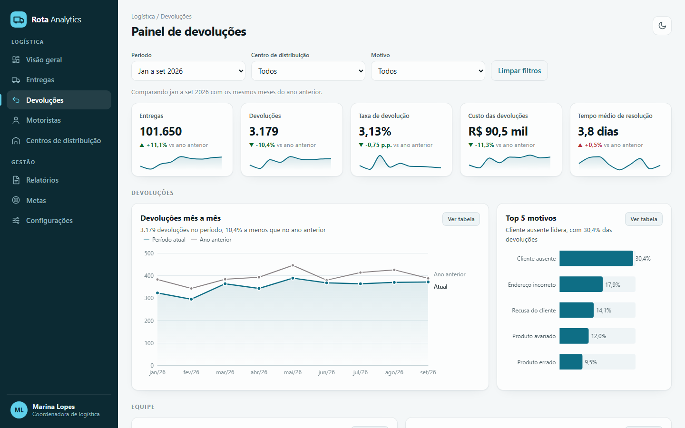

# Rota Analytics, painel de devoluções

**Veja funcionando:** https://deborahdalonso.github.io/logistics-dashboard-demo/

Painel interativo para acompanhar devoluções de uma operação de entregas: quanto voltou, por quê, com quem e quanto custou.

## O que dá para ver

- **Indicadores do período:** entregas, devoluções, taxa de devolução, custo e tempo médio de resolução, cada um com minigráfico e comparação com os mesmos meses do ano anterior.
- **Devoluções mês a mês** contra o ano anterior.
- **Top 5 motivos de devolução**, **top 5 motoristas** com a taxa sobre as entregas de cada um e **top 5 colaboradores** da separação e conferência.
- **Taxa de devolução por centro de distribuição**, contra a média geral, e **custo das devoluções por motivo**.

## Como usar

- Os filtros de período, centro de distribuição e motivo valem para o painel inteiro.
- Clicar num motivo, motorista, colaborador ou centro também filtra tudo. Clicar de novo desfaz.
- Cada gráfico tem o botão **Ver tabela**, com os números completos.
- Tema claro e escuro no canto superior direito. No celular, o menu abre pelo botão de três linhas.

## Como foi feito

- **Dados fictícios gerados em Python**, com sazonalidade de fim de ano, motoristas e colaboradores com desempenhos diferentes e melhora em 2026, para o comparativo anual contar uma história.
- **Painel em HTML, CSS e JavaScript**, com Apache ECharts.
- **Paleta validada** para contraste e daltonismo nos dois temas.
- **Página estática** no GitHub Pages.

Empresa, nomes, menu e usuária são fictícios.

Desenvolvido por [Deborah Dalonso](https://www.linkedin.com/in/deborah-dalonso-482099138).
